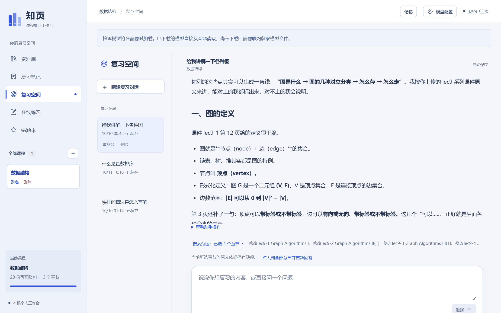
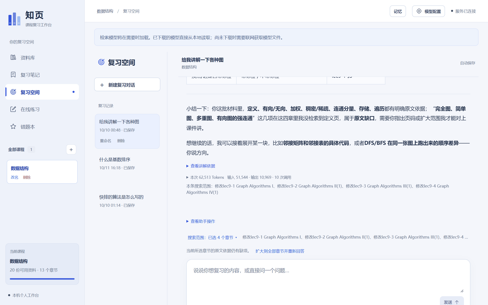
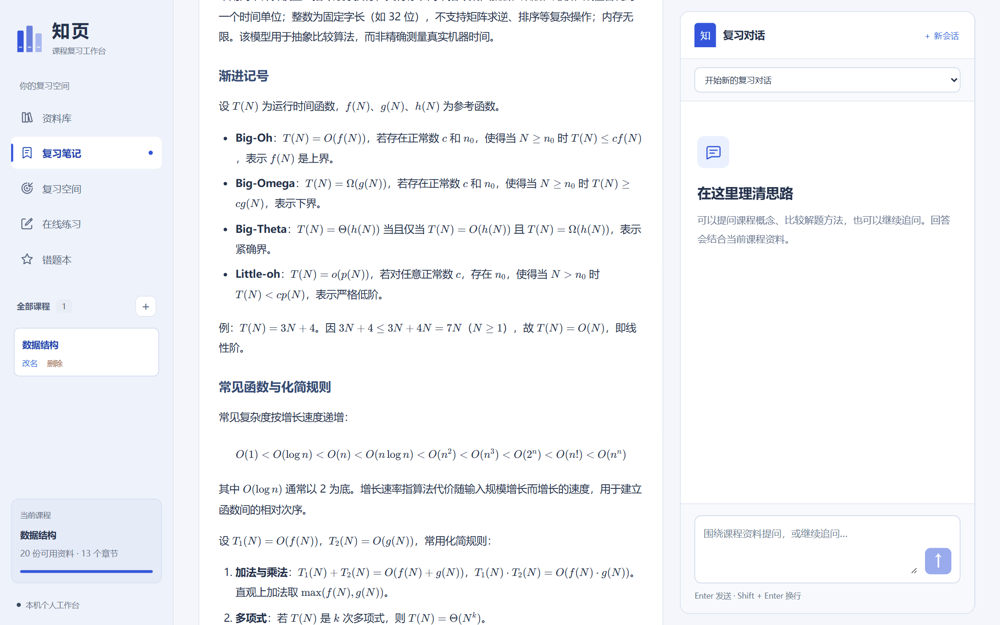
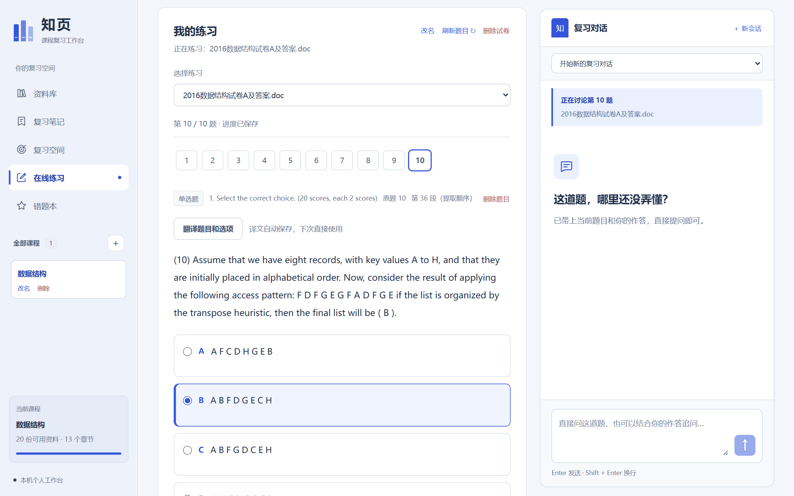
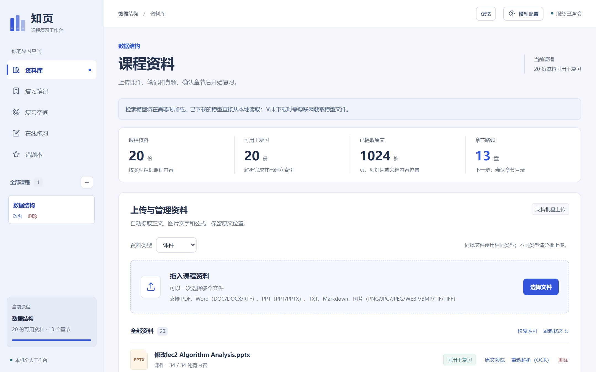
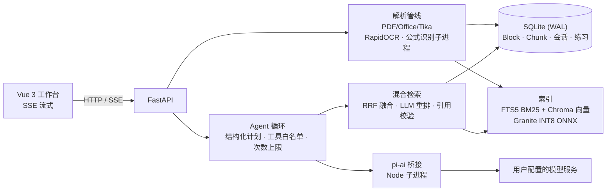

# 知页 · 期末复习 Agent


一个**依据课程原文作答**的本地复习 Agent：上传课件、笔记和往年试卷，它会生成中文复习笔记、围绕原文讲解和追问、按要求出题，并记录错题和学习情况。

重点解决两个问题：**用中文提问也能找到英文课件里的原文**；**“列举 / 对比”类综合问题不只召回少数几页**，覆盖不到的地方明确告诉用户。



## 为什么做这个

复习时课件是英文 PPT，笔记、真题和答案散在不同文件里。直接问通用聊天模型，得到的往往是教材式答案，不一定符合老师课件的口径，也无法回到原文核对。所以我把“上传资料 → 整理笔记 → 依据原文问答 → 练习 → 错题”做成一个完整流程，并让每次回答都能追溯到具体页码。

项目面向 Windows 本机单用户：课程资料、数据库和索引都在本地，只有生成所需的文字和题图会发送到用户自己配置的模型服务。

## 功能

| 模块 | 说明 |
| --- | --- |
| 资料库 | PDF、Word、PPT、文本、Markdown、图片；本地 OCR 与公式识别，保存原文位置供预览 |
| 复习笔记 | 按章节分批读取原文生成中文 Markdown 笔记，保留“中文（English）”术语对照，KaTeX 渲染公式 |
| 复习空间 | 对话式讲解与追问；Agent 自主决定检索、讲解、找题或出题；可限定章节范围 |
| 在线练习 | 整理上传的试卷并关联答案；按章节、知识点或薄弱点 AI 生题；英文题可翻译 |
| 错题本 / 学习记忆 | 答错自动收录；保存讲解偏好与学习记录，用于安排复习，不作为知识依据 |
| 模型接入 | 多服务商、多模型切换，支持 API Key、订阅 OAuth 登录和 Ollama 等本地服务 |

| 原文缺口提示与本次 Tokens | 复习笔记（KaTeX 公式） |
| --- | --- |
|  |  |
| **试卷练习（原题定位、翻译、进度保存）** | **资料库** |
|  |  |

## 架构



一次“列举并比较课件里的各种搜索树”的请求大致经过：

```text
识别请求类型（列举 / 对比 / 仅限原文）
  → 从当前有效笔记读取双语术语与标题层级，展开子主题和比较维度
  → 每个子主题分别做 BM25 + 向量召回，RRF 合并，按原文单元去重
  → 模型重排并给出逐字引用，程序校验引用确实存在于原文
  → 按输入预算放入整页或段落，裁剪后再次检查引用和覆盖缺口
  → 缺项补搜一次；仍缺则在回答中说明
  → 生成回答，保存实际证据、检索诊断、行动轨迹和 Token 用量
```

## 技术要点

**1. 页 / 小节级上下文单元**
PPT/PDF 按页、Word/文本按小节组织成检索单元，再切成约 300 token 的向量片段（每片段带本页标题）。用短片段召回、读回整页原文，避免只拿到标题而丢掉正文和代码。见 [`retrieval_units.py`](backend/app/retrieval_units.py)、[`knowledge_index.py`](backend/app/knowledge_index.py)。

**2. 跨语言混合检索**
SQLite FTS5 BM25 负责精确术语和代码名，本地 Granite 311M 多语言模型（INT8 ONNX，CPU）负责语义匹配，两路用 RRF（k=60）融合，不直接比较两种分数。中文问题的关键词扩展复用笔记里已有的“中文（English）”对照，且英文原词必须真实出现在当前章节原文中——不额外调用模型翻译，也不维护固定词表。见 [`retrieval.py`](backend/app/retrieval.py)、[`course_vocabulary.py`](backend/app/course_vocabulary.py)。

**3. 综合问题的证据覆盖**
普通 top-k 容易集中在少数主题。对列举/对比问题，按子主题和比较维度分别召回；重排模型必须返回候选正文中的逐字引用，程序校验引用存在（缓存命中也会对当前原文重新校验）；上下文按模型窗口裁剪后，再检查引用是否还留在最终提示里。见 [`retrieval_ranking.py`](backend/app/retrieval_ranking.py)、[`prompt_budget.py`](backend/app/prompt_budget.py)。

**4. 有边界、可诊断的 Agent 循环**
模型每步输出一个 JSON 计划，程序校验工具名、参数与章节范围后再执行：普通问答最多 3 次检索调用，复习空间每轮最多 6 次行动，联网兜底每轮最多 2 次。每轮保存行动轨迹、实际进入提示的证据、检索诊断和分阶段 Token 用量，失败可以定位到规划、检索、打包或生成阶段；用户要求“仅依据课程资料”时，服务端禁止模型补充和联网。见 [`agent.py`](backend/app/agent.py)、[`review_space.py`](backend/app/review_space.py)。

**5. 工程细节**
- 公式 OCR 跑在独立子进程，超时可回收；旧版 DOC 中 Tika 不输出的上下标，用 Tika 自带的 POI 补读（[`LegacyWordScripts.java`](backend/app/LegacyWordScripts.java)）。
- 模型调用经 Node 子进程桥接 [pi-ai](https://github.com/earendil-works/pi/tree/main/packages/ai)，统一多家服务商的流式输出、用量和 OAuth 凭据（带文件锁的凭据存储）。
- 重排结果按来源缓存，证据齐全时跳过一次规划调用；回答下方显示本次 Token 与调用次数。
- 生成任务分批写检查点，后端重启后可恢复；前端用请求代次丢弃切换课程/会话后返回的过期响应。
- Windows 便携版：合并 Python 环境、jlink 裁剪 JRE，解压即用（[Releases](https://github.com/Lykon661/zhiye-review-agent/releases)）。

## 评测

自建数据结构课程 30 例诊断集（[`data_structures.jsonl`](scripts/evaluation/data_structures.jsonl)），覆盖知识问答、中文问英文资料、代码解释、综合比较、资料外问题和多轮复习流程。评测脚本从数据库一致性副本重建索引，走真实的复习空间服务，不影响本地数据。

同一套题集、标注和课程资料（哈希一致）下的两次完整运行：

| 指标 | 2026-10-10 | 2026-10-18 | 口径 |
| --- | --- | --- | --- |
| 动作完成率 | 28/30（93.3%） | **30/30（100%）** | 状态、动作类型、题数、范围符合请求；不等于答案正确 |
| 核心回答通过率 | 25/30（83.3%） | **28/30（93.3%）** | AI 逐题复核，非真人评审 |
| 严格任务通过率 | 21/30（70.0%） | **28/30（93.3%）** | 同时要求遵守“仅依据课件”、章节范围、题型题数等限制 |
| 课程证据支持 | 17/24（70.8%） | **22/24（91.7%）** | 实际送入提示的原文能否支持回答，接受等价页 |
| 资料外问题处理 | 2/5（40%） | **5/5（100%）** | 依据不足时如实说明、不越过“仅依据课件”限制 |
| 标注原文进入最终提示 | 32/48（66.7%） | **44/48（91.7%）** | 按标注片段计，标注不穷举等价证据，不是 Recall@K |
| 综合比较题的原文覆盖 | 13/25 | **21/25** | 其中“各种排序算法”从 2/12 到 12/12 |
| 系统用量 | 134 万 tokens / 318 次调用 | **105 万 tokens / 216 次调用** | 不含额外评审 |
| 单轮服务耗时（中位数 / P95） | 22.8 s / 44.6 s | 29.7 s / 61.8 s | 含规划、检索、生成 |

**两次条件不同**：向量模型由 BGE-small-zh 换成 Granite 多语言模型，笔记术语扩展、证据覆盖校验、范围遵循等代码有修改，对话模型也由 deepseek-flash 换成了 gpt-5.6-luna（耗时变长主要与此有关）。因此提升不能全部归因于检索改进，同模型的对照还需要再跑一次。

这次运行也暴露出新问题：对比题改由本地笔记术语展开子主题后，泛词别名（如“搜索树”里的“树”）会挤掉具体子主题，ds19、ds21 两题的覆盖率下降。之后已修复：保留规划器的子查询、抑制泛词匹配、修正术语抽取边界，**修复后尚未重新评测**。方法、指标定义与复现方式见 [评测说明](docs/EVALUATION.md)。

## 快速开始

### Windows 便携版

在 [Releases](https://github.com/Lykon661/zhiye-review-agent/releases) 下载 `Zhiye-版本-windows-x64.zip`，完整解压后双击 **启动知页.cmd**，浏览器打开 `http://127.0.0.1:8000/`。运行环境和本地识别模型都在包内，问答仍需配置自己的模型服务。详见 [便携版说明](docs/PORTABLE.md)。

### 从源码运行

需要 Python 3.11、[uv](https://docs.astral.sh/uv/) 0.11.7+、Node.js 22.19+；解析 DOC/PPT/RTF 另需 JDK 11+（只用 PDF/DOCX/PPTX/图片时可加 `-SkipTika` 跳过）。

```powershell
powershell -NoProfile -ExecutionPolicy Bypass -File .\scripts\setup.ps1
.\run.cmd
```

打开 [复习工作台](http://127.0.0.1:5173/)（API 文档在 `http://127.0.0.1:8000/docs`），在右上角 **模型配置** 添加服务商与模型并保存，然后创建课程、上传资料。完整步骤见 [使用说明](docs/USAGE.md) 和 [模型配置](docs/MODEL_CONFIG.md)。

### 测试

```powershell
uv run pytest
npm --prefix frontend test
```

后端测试覆盖解析、分块、混合检索与术语扩展、输入预算、Token 统计、生成检查点与重启恢复、删除生命周期等；前端测试覆盖 SSE 解析、草稿持久化和练习进度。

## 项目结构

```text
backend/app/
  main.py                    FastAPI 路由与 SSE
  parsing.py, tika.py        文档解析；ocr / 公式识别见 visual_recognition.py、formula_worker.py
  retrieval*.py              向量 + BM25 混合召回、RRF、重排与引用校验
  knowledge_*.py             页/小节级知识索引与检索
  course_vocabulary.py       从笔记提取并核验双语术语
  agent.py                   复习对话的检索工具循环
  review_space.py            复习空间：规划 → 检索/讲解/出题 的多步 Agent
  practice*.py               试卷整理、AI 生题、判题与进度
  memory.py                  学习记忆与会话摘要
  llm.py, model_*.py         模型调用、配置与 OAuth
backend/tests/               后端测试
frontend/src/                Vue 3 + TypeScript 工作台
model-runtime/               pi-ai 模型调用桥接（Node）
scripts/                     安装、启动、评测、便携版打包
docs/                        使用、模型配置、检索设计、评测说明
```

## 局限

- 面向本机单用户，没有账号体系和公网部署方案；后台任务用 FastAPI BackgroundTasks 在进程内执行，不是分布式队列。
- 复杂图形、版式、部分旧 Office 公式和低置信度 OCR 内容可能被跳过。
- 综合列举依赖笔记里的术语和标题，清单可能不完整；系统会标记缺项，但不能保证全覆盖。
- 选择题可能按模型参考答案判题，界面会标明判题依据；模型答案可能有误。
- 评测只有一门课程、公开的 30 题和 AI 复核，两次运行的对话模型也不同；还需要真人复核、未参与调参的独立题集和同模型的前后对照。

## 文档

- [使用说明](docs/USAGE.md) · [模型配置](docs/MODEL_CONFIG.md) · [课程知识检索设计](docs/RETRIEVAL.md) · [评测说明](docs/EVALUATION.md) · [便携版](docs/PORTABLE.md)
- [致谢与第三方来源](docs/ACKNOWLEDGEMENTS.md)：项目起步于学习 [Datawhale Hello-Agents](https://github.com/datawhalechina/hello-agents)。

## 许可证

[MIT](LICENSE)。第三方组件和模型遵循各自的许可证。
